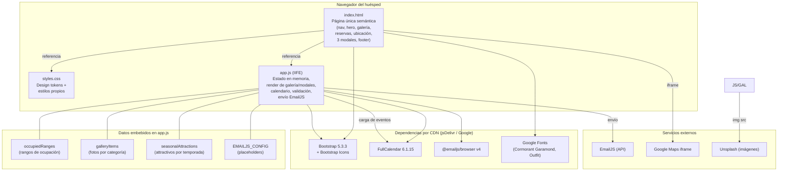

# C4 Nivel 2 — Contenedores

Sistema: **Cabañas Hueltén**. El sitio es una aplicación estática de un solo contenedor de código + los CDNs que consume.

## Contenedores

| Contenedor | Responsabilidad | Tecnología |
|------------|-----------------|------------|
| `index.html` | Estructura semántica de la página única, modales y puntos de montaje (`#galleryGrid`, `#reservationCalendar`, `#seasonCards`) | HTML5 |
| `styles.css` | Design tokens de marca, estilos de componentes propios y overrides de FullCalendar | CSS3 |
| `app.js` | Único módulo IIFE: estado, `renderGallery`, `renderSeason`, `initCalendar`, validación de rangos (`isRangeOccupied`), `sendReservation` | JavaScript ES2020 |
| `foto.png` | Logo/favicon | PNG |

## Notas de arquitectura

- **Sin capa de servidor:** no hay backend, base de datos ni API propia (SPEC NG-01/NG-02; ver ADR-002 y ADR-003).
- **Contrato con EmailJS:** único punto de integración externa con lógica; si `EMAILJS_CONFIG.publicKey` es placeholder, `sendReservation` lanza error `config` y el UI muestra el fallback (RF-07).
- **Validación en cliente** (RF-06): solapes se calculan con `datesOverlap` sobre `occupiedRanges`; es la única "regla de negocio" con estado.
