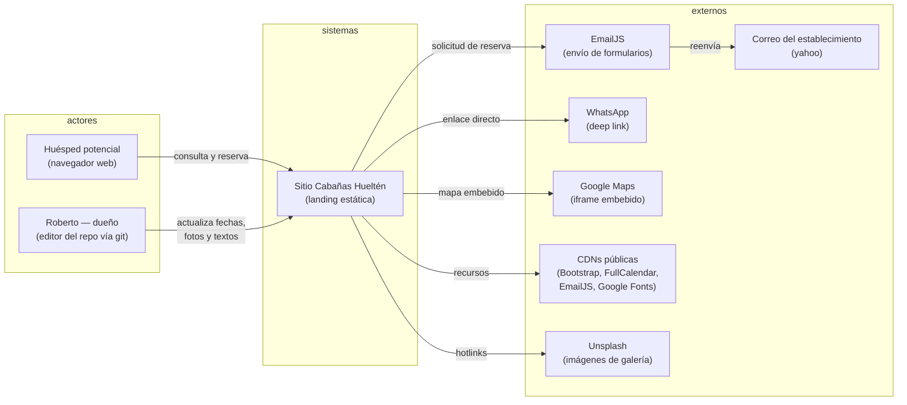

# C4 Nivel 1 — Contexto del Sistema

Sistema: **Cabañas Hueltén — Landing y Solicitudes de Reserva**.
Los diagramas usan Mermaid y renderizan en GitHub.

## Actores

| Actor | Rol | Interacción |
|-------|-----|-------------|
| Huésped | Visitante del sitio, cliente final | Navega, filtra galería, consulta el calendario, envía solicitud de reserva |
| Dueño | Roberto, propietario de las cabañas | Mantiene el repo: actualiza `occupiedRanges`, galería, políticas y claves de EmailJS mediante commits/PRs |

## Sistemas externos

| Sistema | Uso | Dependencia |
|---------|-----|-------------|
| EmailJS | Envío del formulario al correo del establecimiento | API pública del navegador; si no está configurado, fallback a `mailto:` y WhatsApp |
| WhatsApp | Canal directo de contacto | Deep link `api.whatsapp.com/send` |
| Google Maps | Mapa de ubicación en Malargüe | iframe embebido |
| CDNs (jsDelivr, Google Fonts) | Bootstrap, Bootstrap Icons, FullCalendar, EmailJS SDK, tipografías | Sin caché local; el sitio requiere conexión |
| Unsplash | Imágenes de la galería y del hero | Hotlinks con parámetros de tamaño |
