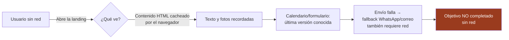

# Offline / Sincronización — Non-Goal declarado y justificado

**Decisión:** el proyecto **NO implementa estrategia offline ni sincronización**. Corresponde al **NG-06** del SPEC ("sin PWA ni experiencia offline: depende de CDNs, mapa embebido y EmailJS").

## Justificación (por qué es correcto para este producto)

1. **El dato crítico no puede estar viejo:** la única información por la que el usuario reserva es la **ocupación del calendario**. Servir una versión cacheada de `app.js` significaría mostrar fechas "libres" que ya no lo están → reserva negada después (pérdida de confianza, costo real para el dueño).
2. **La acción crítica necesita red:** enviar la solicitud (EmailJS) o escribir por WhatsApp son operaciones online; offline el usuario no completa el objetivo — solo leería contenido de marketing que ya visitó.
3. **Consistencia de decisiones:** PWA fue descartada en ADR-005 y ADR-006 con el mismo criterio (frescura > disponibilidad offline); una decisión contradictoria aquí rompería la trazabilidad ADR ↔ SPEC ↔ restricciones.
4. **Costo/beneficio:** un service worker agrega superficie de fallo (caché stale, invalidación, actualización silenciosa) para un sitio de 4 archivos cuyo valor offline es casi nulo.

*Por qué no se implementa:* el diagrama muestra que incluso con caché el flujo de reserva no se completa sin red — el offline no resuelve ningún objetivo del usuario, solo agrega riesgo de datos viejos.

## Qué SÍ cubre el sitio ante fallas de red (ya implementado)

- Si EmailJS falla o no está configurado: **fallback visible** a correo y WhatsApp (RF-07, test 7/8).
- Botón flotante de WhatsApp siempre presente (canal redundante).
- Navegador nativo: el usuario puede usar "caché del navegador" a su riesgo — no lo garantizamos ni lo invalidamos (evitamos `no-store` agresivo para no degradar el rendimiento).

## Si esto cambia (condición de reapertura)

Solo se reabre este Non-Goal si el dueño necesita **cargar reservas desde el lugar sin señal** (ej. modo anfitrión offline). En ese caso: estrategia de 1 página (sección Reservas) con snapshot de `occupiedRanges` con timestamp visible — diseño nuevo, nuevo ADR.
