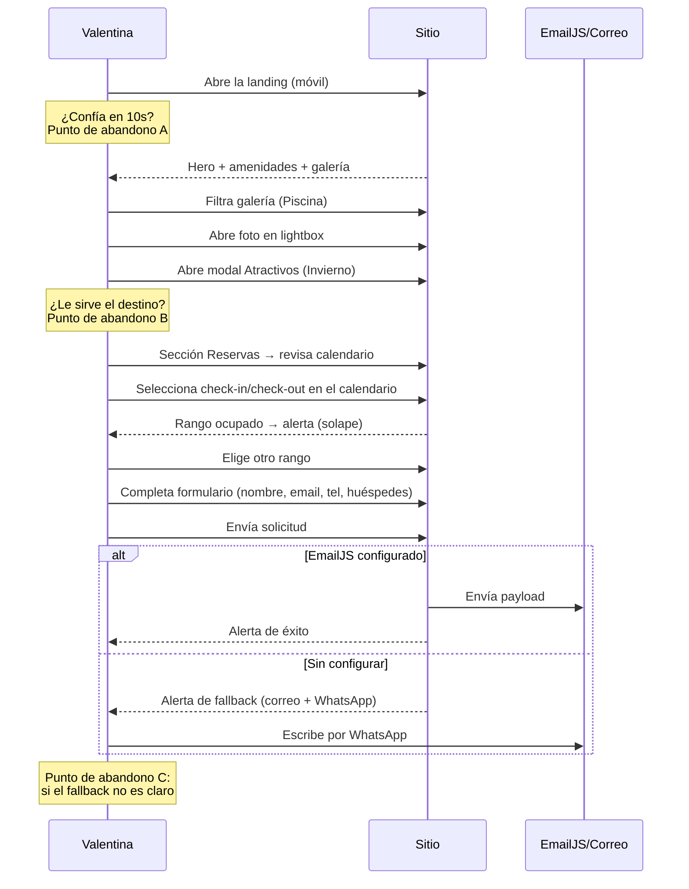
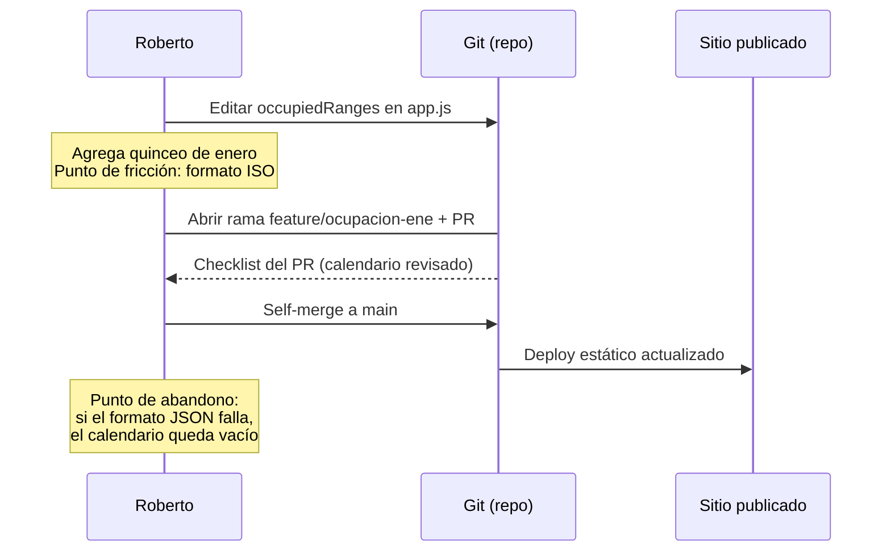

# Personas y User Journeys — Cabañas Hueltén

Dominio real del proyecto: alojamiento de montaña en Malargüe gestionado por su dueño, con reservas por formulario (no por motor online).

---

## Persona 1 — Valentina, huéspeda de Cuyo

| Atributo | Detalle |
|----------|---------|
| Edad / rol | 34 años, docente, vive en Córdoba capital |
| Contexto | Viaja con su pareja y dos hijos (6 y 9); planifica con 1–2 meses de anticipación |
| Motivación | Escapada de invierno a la cordillera: quiere cabaña con chimenea, piscina y seguridad para los niños |
| Frustraciones | Sitios de alojamiento sin fotos reales; formularios que no dicen si la fecha está libre; esperar días por una respuesta |
| Cómo llega | Instagram/Google → landing → WhatsApp si no encuentra lo que busca |
| Escenario crítico | Necesita ver si su semana de julio está libre **antes** de escribir; si el sitio no muestra disponibilidad clara, cierra la pestaña y sigue buscando |

**Cita:** *"Si no veo el calendario y las fotos rápido, sigo de largo con el celular en la mano."*

---

## Persona 2 — Roberto, dueño de las cabañas

| Atributo | Detalle |
|----------|---------|
| Edad / rol | 52 años, propietario y administrador del alojamiento |
| Contexto | Gestiona reservas por WhatsApp/gmail; tiene alguien que lo asiste con el sitio (git) |
| Motivación | Recibir solicitudes ordenadas (fechas, cantidad de huéspedes, contacto) y mostrar el lugar las 24 h |
| Frustraciones | Mensajes incompletos sin fechas; tener que repetir políticas (seña, cancelaciones) por chat |
| Cómo interactúa | Actualiza las fechas ocupadas en `app.js` y publica con un commit; responde solicitudes por correo |
| Escenario crítico | En temporada alta alguien pide un rango ya reservado: si el calendario no lo muestra, pierde tiempo y credibilidad |

**Cita:** *"Prefiero mil solicitudes con fecha clara que diez conversaciones para saber qué noche quieren."*

---

## Journey 1 — Valentina: descubrir y solicitar reserva

**Mitigación de abandono:**
- **A (primeros 10 s):** CTA "Reservar Ahora" visible en hero y nav sticky; franja de amenidades de inmediato.
- **B (evaluación):** modal de atractivos por temporada responde "¿qué hago ahí en julio?".
- **C (envío):** alerta con fallback explícito a correo y WhatsApp (RF-07) + botón flotante de WhatsApp siempre presente.

---

## Journey 2 — Roberto: publicar nueva disponibilidad

**Mitigación de fricción:** el contrato `OccupiedRange` del SPEC documenta el formato ISO `YYYY-MM-DD`; el arnés prohíbe tocar la validación de solapes, de modo que un rango mal cargado se detecta en el PR y no en producción.
