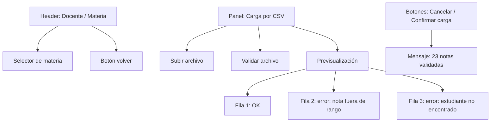

# Wireframe — Docente: Carga de Calificaciones

> Objetivo: que el docente cargue notas de una materia con validación clara, sin errores ambiguos.

## Objetivo
- Seleccionar una materia.
- Cargar calificaciones por formulario o CSV.
- Validar antes de confirmar la operación.

## Entrada principal
- CSV o formulario con la nota del estudiante.
- Selección de materia activa.

## Error más probable
- El docente sube un CSV con filas o notas fuera de rango.

## Cómo se previene
- Muestra un resumen de validación antes de guardar.
- Marca cada fila errónea con el motivo exacto.
- Requiere confirmación final antes de persistir.

## Wireframe (Mermaid)

## Observaciones de diseño
- La acción principal (confirmar carga) está separada de la tarea de subir archivo.
- El resumen del CSV hace el proceso más seguro y legible.
- La validación específica reduce la relectura y mejora la autonomía del usuario.
