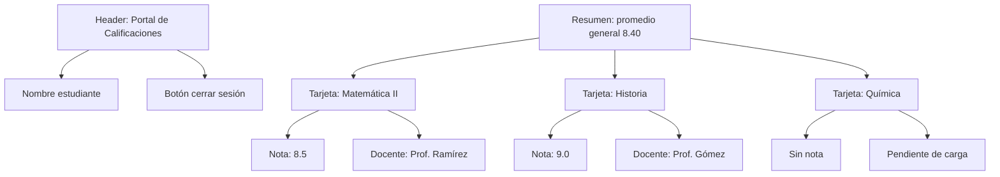

# Wireframe — Estudiante: Mis Calificaciones

> Objetivo: que el estudiante vea todas sus notas por materia con contexto y promedio general.

## Objetivo
- Ver materias asociadas a su usuario.
- Identificar rápidamente la nota y el nombre del docente.
- Entender el promedio general sin complejidad extra.

## Entrada principal
- Sesión activa del estudiante.
- Materias asociadas a su inscripción.

## Error más probable
- El estudiante no distingue si hay materia sin nota o si la nota aún no fue cargada.

## Cómo se previene
- Mostrar estado explícito: “Sin nota” o “Pendiente”.
- Resaltar la materia activa con un borde o fondo claro.
- Mostrar un mensaje de ayuda corto bajo el bloque de promedio.

## Wireframe (Mermaid)

## Observaciones de diseño
- La acción principal está arriba del contenido.
- La jerarquía visual prioriza el promedio general.
- Se usa lenguaje claro y familiar para el estudiante.
- El foco y la navegación por teclado son elementos de mejora a validar en la auditoría.
