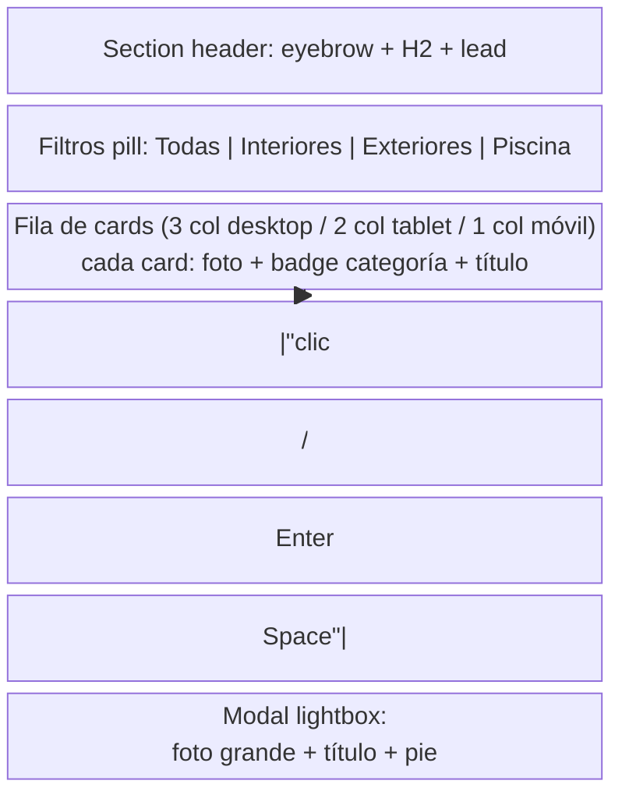
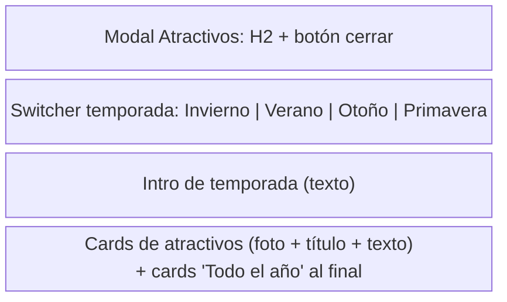

# Wireframe — Pantalla crítica 2: Galería filtrable + Modal de atractivos

**Pantallas:** ancla `#galeria` + modal `#attractionsModal` de `index.html`.
**Objetivo:** que el huésped evalúe el lugar (fotos) y el destino (actividades por temporada) en menos de un minuto.

| Elemento | Objetivo | Entrada | Error más probable | Prevención |
|----------|----------|---------|--------------------|------------|
| Filtros de galería | Reducir el ruido de 9 fotos (RF-02) | Click en pill | No saber cuál filtro está activo | Pill activo con estilo `active` + estado `aria-pressed` sincronizado (fix de auditoría H-01) |
| Cards de foto | Abrir detalle (RF-03) | Clic / teclado | Card con `role=button` que no responde al teclado | `tabindex="0"` + handler de `keydown` (Enter/Espacio) con `preventDefault` |
| Lightbox | Ver foto en tamaño real | Clic en card o botón cerrar / backdrop / Esc | — | Modal de Bootstrap con foco gestionado y `aria-hidden` |
| Switcher de temporada | Cambiar atractivos (RF-08) | Click en botón | No ver qué estación está seleccionada | `aria-pressed` + clase `is-on` en la estación activa |
| Cards de atractivos | Inspirar la estadía | Lectura | — | Badge "Todo el año" distingue los items permanentes |

**Decisiones de diseño:**
- La galería se renderiza desde `galleryItems` (ADR-003): agregar una foto es un commit, no un CMS.
- El lightbox reutiliza un único modal del DOM (sin clonar modales por foto).
- El modal de atractivos abre desde dos places (nav y hero) para no forzar scroll.
