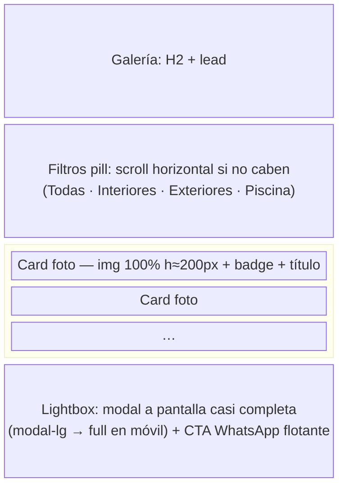

# Wireframes Móviles — 2 pantallas críticas (< 400 px)

Breakpoint de referencia: **393 px** (típico móvil 2026). Targets táctiles: **≥ 48 px** (Material) / 44 pt (Apple HIG).

---

## Pantalla 1 — Sección Reservas (versión móvil)

```mermaid
block-beta
  columns 1
  H["H2 + lead ( centrado, apilado)"]
  block:CAL["Calendario (tarjeta surface-card)"]
    columns 1
    T["H5 + leyenda Libre/Ocupado (apilada)"]
    FC["FullCalendar mes completo<br/>(toolbar prev | title | next)"]
  end
  block:FORM["Formulario (tarjeta, 1 columna)"]
    columns 1
    N["Nombre * — alto 48px"]
    E["Email * — alto 48px"]
    TEL["Teléfono * — alto 48px"]
    G["Huéspedes * — alto 48px"]
    CI["Check-in * / CO["Check-out *"] — apilados"]
    M["Mensaje — 4 filas"]
    B["CTA Enviar — alto 52px, ancho 100%"]
    HINT["Hint fallback"]
  end
```

### Comparación con desktop (≥ 992 px) y nota de cambios

| Elemento | Desktop | Móvil < 400 px | Motivo del cambio |
|----------|---------|-----------------|-------------------|
| Columnas calendario/formulario | `col-lg-6` / `col-lg-6` lado a lado | **Apiladas** (1 columna, calendario primero) | En 393 px dos columnas dejan tarjetas ilegibles; el calendario decide el rango antes de llenar datos |
| Leyenda Libre/Ocupado | fila horizontal junto al título | **Apilada** debajo del H3 (`.legend` en columna) | Evita desborde con el toolbar del calendario |
| Toolbar FullCalendar | `prev | title | next` en fila | Se comprime (`.fc-toolbar { flex-direction: column }` ya existe en `styles.css`) | El `title` con año no cabe en fila |
| Inputs del formulario | 2 por fila (`col-md-6`) | **1 por fila** | Targets de 48 px y autofill cómodo con teclado en pantalla |
| CTA "Enviar" | ancho de columna | **ancho 100%, alto 52 px** | Accesible con una mano (zona inferior) |
| Nav | 6 items expandidos | Toggler hamburguesa (colapsada) + CTA "Reservar" | Patrón estándar, evita scroll horizontal |

---

## Pantalla 2 — Galería + lightbox (versión móvil)



### Comparación con desktop y nota de cambios

| Elemento | Desktop | Móvil < 400 px | Motivo del cambio |
|----------|---------|-----------------|-------------------|
| Grid de galería | 3 columnas (`col-lg-4`) | **1 columna** (`col-12`) | Fotos legibles sin zoom; scroll natural |
| Filtros | fila centrada | fila **scrollable horizontal** si excede el ancho | 4 pills × ≥ 48 px ≈ 300 px + gaps → puede desbordar en 393 px |
| Cards | altura 220 px de imagen | mismas cards (reutiliza Bootstrap) | Consistencia; sin cambios estructurales |
| Lightbox | `modal-lg` centrado | **pantalla completa** (`modal-dialog-scrollable` ya activo) | La foto debe aprovechar todo el ancho |
| targets interactivos | ~40 px aceptables | **≥ 48 px** garantizados (pills, cards, cerrar modal) | HIG/Material en toque |
| Botón WhatsApp flotante | 58 px | 58 px (se mantiene, esquina inferior derecha) | Ya cumple ≥ 44 pt; no tapona el CTA porque este es estático en flujo |

## Verificación de targets (checklist de toque)

- [ ] Pills de filtro ≥ 48 px de alto efectivo (`.nav-link` con padding vertical ≥ 0.75rem).
- [ ] Inputs y selects ≥ 48 px (`.form-control` con `padding: 0.75rem` + línea ≈ 48 px).
- [ ] CTA "Enviar solicitud" ≥ 52 px (`.btn-cta` padding 0.7rem + fuente).
- [ ] Cards de galería: área total >> 48 px (bloque completo clicable).
- [ ] Cerrar modal (`.btn-close`, 44 px nativo de Bootstrap) + backdrop.
