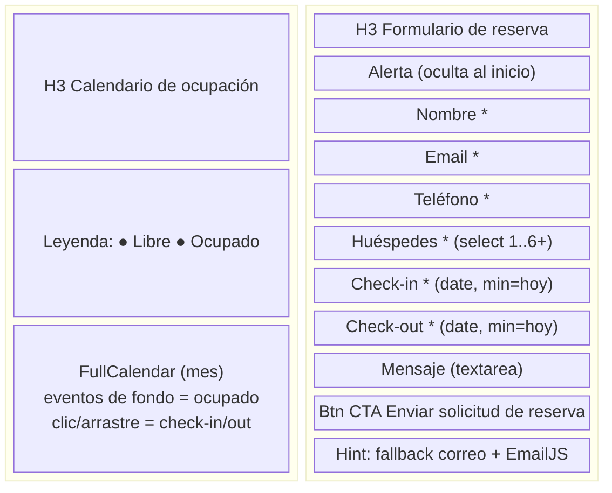

# Wireframe — Pantalla crítica 1: Sección Reservas (calendario + formulario)

**Pantalla:** ancla `#reservas` de `index.html` · **Objetivo:** que el huésped vea disponibilidad y envíe la solicitud sin salir de la sección.
**Ancho de referencia:** desktop ≥ 992 px (dos columnas) y móvil < 768 px (una columna).

| Elemento | Objetivo | Entrada | Error más probable | Prevención |
|----------|----------|---------|--------------------|------------|
| Calendario | Mostrar ocupación y precargar fechas (RF-04/05) | Clic en día o arrastre sobre el mes | Elegir un rango ocupado sin notar el color | `selectOverlap: false` bloquea fechas ocupadas; leyenda Libre/Ocupado visible; alerta si el submit solapa (RF-06) |
| Formulario | Capturar la solicitud completa (RF-06/07) | Campos controlados + date pickers nativos | Enviar incompleto o con checkout < check-in | `required` + `checkValidity()` + validación explícita de orden y solape antes de `sendReservation` |
| Botón enviar | Disparar EmailJS o fallback (RF-07) | Click | Claves placeholder → usuario cree que reservó | Si `publicKey` es placeholder, alerta warning con correo y WhatsApp en lugar de error genérico |
| Hint bajo el botón | Transparencia del canal de envío | Lectura | — | Texto visible con el correo del establecimiento |

**Decisiones de diseño:**
- El calendario y el formulario comparten pantalla: el usuario no cambia de contexto para cruzar disponibilidad con datos.
- El clic en el calendario precarga `checkIn`/`checkOut` (menos tipeo en móvil).
- Los `input[type=date]` llevan `min` = hoy calculado en `app.js` (evita fechas pasadas).
